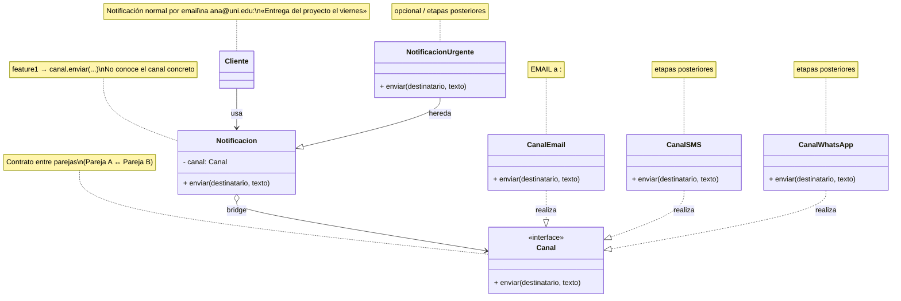

# Diagrama Bridge — Sistema de notificaciones

Mapeo del patrón Bridge al problema de `PROBLEMA.md`.

| UML (genérico) | Este problema |
|---|---|
| Abstraction | `Notificacion` |
| Implementation | `Canal` |
| Concrete Implementation | `CanalEmail` (+ SMS / WhatsApp después) |
| Refined Abstraction | `NotificacionUrgente` / con respaldo (después) |
| Client | quien arma `Notificacion(CanalEmail)` y llama `enviar` |

El puente es el agregado `Notificacion → Canal`: Pareja A crece en tipos de aviso y Pareja B en canales, sin tocar el código de la otra.
